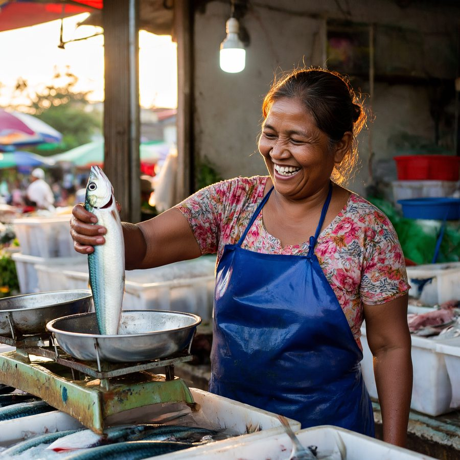
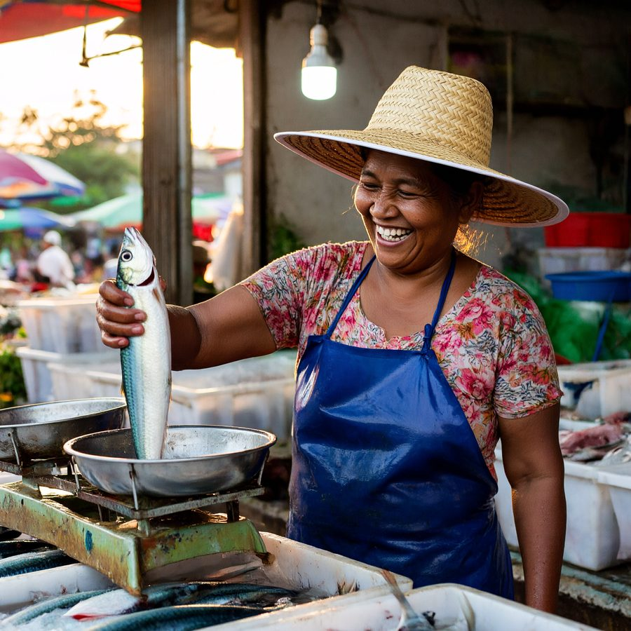
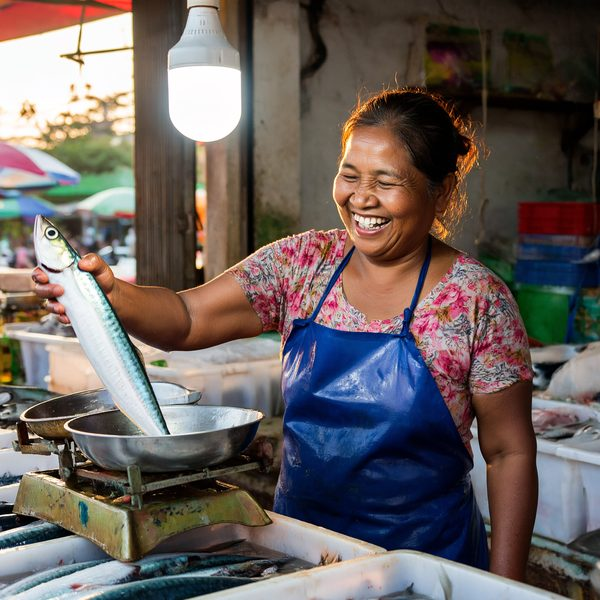
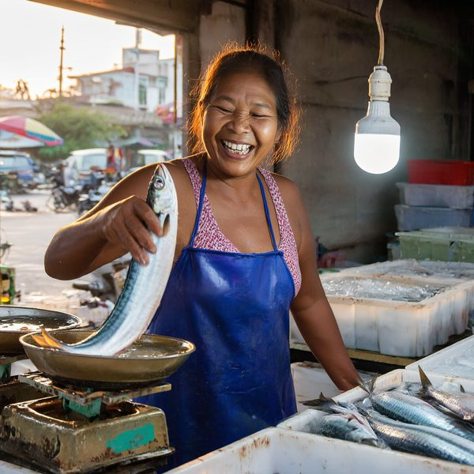

# h3mlx

Two models in [MLX](https://github.com/ml-explore/mlx), for Apple silicon:

- **MiniMax H3:** text and reference images to video with sound.
- **[P-H3-Image](#p-h3-image):** Pruna AI's image model built on H3's transformer, for text-to-image and editing with up
  to 8 pictures.

Both were built op by op and tested against their implementations in
[diffusers](https://github.com/huggingface/diffusers) (`transformer_minimax_h3.py`, `scheduling_minimax_h3.py`,
`modular_pipelines/minimax_h3/`, `modular_pipelines/p_h3_image/` and the autoencoders) on small random tensors.

## What's here

- **ref2va end to end:** reference images (and video/audio references) to video and audio, staged so the text encoder
  and the transformer are never resident together.
- **The parts:** the DiT and its token refiner, the scheduler and denoise loop, the packed-sequence layouts (t2va,
  fl2va, ref2va), the Qwen3-VL presentation and text encoder (via mlx-vlm), the video VAE (encoder, ViT decoder,
  tiling) and the audio VAE.
- **HyperFlow:** Video Rebirth's [8-step LoRA](https://github.com/Video-Rebirth/hyperflow) (`--hyperflow`), 8
  transformer calls instead of 49.
- **P-H3-Image:** both workflows end to end, its text connector, the single-frame image decoder, and its prompt
  upsampler (Qwen3.5-9B, via mlx-vlm). It reuses H3's transformer, packing and denoise loop unchanged.
- **Porting guides:** [`docs/porting.md`](docs/porting.md) (diffusers -> h3mlx),
  [`docs/porting-hyperflow.md`](docs/porting-hyperflow.md) and
  [`docs/porting-p-h3-image.md`](docs/porting-p-h3-image.md), side by side, with permalinks to the originals. Each
  is rendered from its `.md.j2` template with [projected-source](https://github.com/sublimator/projected-source); the
  template's header says which upstream checkouts it reads.

## Tests

    uv sync
    uv run pytest

No weights are needed. A plain clone runs 228 tests and skips 70. Those 70 need the releases' tokenizers, processors,
configs and weight indexes, plus HyperFlow's manifest and adapter header. These files aren't shipped here because they
belong to MiniMax, Video Rebirth and Pruna. Fetch them from Hugging Face at pinned revisions (about 50 MB, no weights)
and all 298 run:

    uv run python scripts/fetch_test_fixtures.py   # writes tests/data/release/ (git-ignored)
    uv run pytest

Or point `H3MLX_FIXTURES` at a copy. Seven of the 70 also need `ffmpeg` and `ffprobe` on the `PATH`.

The oracle is diffusers main at `d3d8af89` (P-H3-Image isn't in a diffusers release yet); its H3 code is 0.42.1's plus a
tensor-parallel plan, and the H3 tests pass against both.

## Running H3

You need:
- **The MiniMax H3 weights:** `MiniMaxAI/MiniMax-H3` on Hugging Face, tested at revision `42ed227` (about 144 GB).
  `scripts/check_weights.sh` checks a local copy against its sizes and sha256s.
- **For `--hyperflow`, the HyperFlow adapter:** `minimax_h3_hyperflow_8step_v1.0.safetensors` from
  `VideoRebirthAI/hyperflow`, revision `5bde94d7`. The run script checks its sha256 (`9297f450...f447`).
- **`ffmpeg` and `ffprobe`** with H.264 and AAC encoders. The script checks the writer before loading any model.
- **A reference image and a prompt file.**

    bash scripts/check_weights.sh MiniMax-H3
    uv run python scripts/run_ref2va.py --weights MiniMax-H3 --image ref.png --prompt-file prompt.txt \
        --height 576 --width 1024 --frames 124 --seed 0 --ref-short-edge 768 --out out/run \
        --hyperflow minimax_h3_hyperflow_8step_v1.0.safetensors

`--plan-only` prints the sizes a run would use without reading any weights. The script writes `video.mp4` (with sound),
`audio.wav`, the final latents and a `run.json` with per-stage times and memory.

`--ref-short-edge 768` sizes the reference image at 768 px on its short edge. The release's rule (the default) is 2048,
which adds many rows to the sequence and makes runs much slower (see the table).

**Measured on an M3 Ultra (60-core GPU, 256 GB),** one image reference, 124 frames (5.2 s), bf16, dense attention:

| output | reference short edge | calls | total |
| --- | --- | --- | --- |
| 512x288 | 512 | 49 (base) | 16.9 min |
| 512x288 | 512 | 8 (HyperFlow) | 3.5 min |
| 672x384 | 768 | 8 (HyperFlow) | 6.7 min |
| 1024x576 | 768 | 8 (HyperFlow) | 16.5 min |
| 1344x768 | 2048 | 8 (HyperFlow) | 54 min |

The denoise peak was 70-88 GB. At 384p faces and clothing broke down; 576p held up better. HyperFlow adds some
frame-to-frame shimmer against the base model.

## P-H3-Image

[P-H3-Image](https://huggingface.co/PrunaAI/P-H3-Image) (Pruna AI) is an image model built from MiniMax H3: H3's
transformer (the same architecture and weight names, fine-tuned), a Qwen3-VL-4B text encoder whose hidden states 13,
19, 25, 31 and 36 a small connector maps to the transformer's text input, an image VAE (H3's encoder and latent space,
a single-frame ViT decoder), and a Qwen3.5-9B prompt upsampler. It samples 8 steps on its own sigma grid with no
guidance and works best at 8 MP. `h3mlx.image` runs both workflows, text-to-image and editing (Picture 1 is edited,
up to 7 more are references), and `h3mlx.upsampler` runs the upsampler with mlx-vlm.

### Examples

Made with this port on an M3 Ultra, from the release at seed 0.

**Text-to-image, then an edit of it.** Left: 8 MP from the prompt below as written, 4.2 min. Right: "give her a wide
straw hat" with `--upsample`, 10.5 min. The face, the fish, the scale and the light are kept.

| text-to-image | edit: "give her a wide straw hat" |
| --- | --- |
|  |  |

The text-to-image prompt

> A documentary photograph taken by an experienced street photographer on a 35mm lens. At dawn in a Phnom Penh wet
> market, a middle-aged fishmonger in a faded blue apron laughs as she lifts a silver mackerel onto a dented brass
> scale. Behind her are stacked ice crates and a hanging bare bulb; soft daylight comes from an open doorway on the
> left, and the bulb puts a warm rim of light on her hair. Shallow depth of field, natural skin texture, a little
> motion blur on her hand.

**A chain of edits.** The source picture was made with ChatGPT. Each edit starts from the one before, with
`--upsample`, on a 2368x1760 canvas, in about 4.7 min.

| source (made with ChatGPT) | "have the girl turn around to face the camera and the cat sleepily waking up" |
| --- | --- |
|  |  |
| **fix the Rubik's cube** | **"make the ghost in the screen turn towards the camera too"** |
|  |  |

The cube took two tries. "fix the rubix cube, it needs to be a cube" gave a flat slab five stickers wide; spelling out
the geometry ("a real 3x3x3 Rubik's cube seen from a corner, so three faces show, each face exactly three rows of three
square stickers") gave the cube above, a little larger than asked and not in Rubik's colours. Turning the ghost cost
it the reaching hand it had in the source.

You need the weights: `PrunaAI/P-H3-Image`, tested at revision `7f98ace` (about 100 GB with the upsampler, 81 GB
without).

    uv run python scripts/run_p_h3_image.py --weights P-H3-Image --prompt-file prompt.txt --out out/img
    uv run python scripts/run_p_h3_image.py --weights P-H3-Image --prompt-file edit.txt --image photo.png \
        --image hat.png --upsample --out out/edit

Without `--upsample` the prompt is rendered as written, so write it the way the model card says: say what the image
is, describe one scene, quote every word of text, leave out hype words. `--upsample` runs the upsampler first, as the
diffusers pipeline does by default (its greedy decoding can differ from torch's in places; the prompt it wrote is saved
as `prompt.txt`). `--plan-only` prints the sizes without reading weights.

Sizes follow the pipeline. Text-to-image defaults to 2912x2912 (8 MP); the card lists the 8 MP size for each aspect
ratio, and other sizes are rounded to multiples of 32. An edit is generated at Picture 1's size, scaled up to at least
4 MP, unless `--height` and `--width` set the canvas; the pictures keep their own sizes between 1 and 8 MP, so each
one adds its rows to the sequence. `--sigmas` replaces the 9-point grid. The VAE decodes in float32 by default;
`--vae-dtype bfloat16` loads it the way the pipeline does (bfloat16, with the encoder, `quant_conv` and the decoder's
`proj_out` kept in float32). The script writes `image.png`, `prompt.txt` (the prompt rendered), the final latents
(with a record of the request that made them) and a `run.json` with per-stage times and memory. `--decode-from`
re-decodes saved latents on their own: it takes no prompt or sampling options, checks the rows, and logs the saved
request as its source.

The AdaLN modulation depends only on the timestep, and a run makes 8 calls, so the script computes each call's tables
up front and drops the 13B `adaln_proj` parameters (26 GB in bf16) block by block as it goes (`--no-modulation-cache`
turns that off). Each call's tables are computed from that call's own timesteps, so a cached run is bit-identical to
an uncached one. (A first version batched all the timesteps into one product, which rounds differently in bf16 and
drew a different picture from the same seed.)

**Measured on the M3 Ultra (60-core GPU, 256 GB),** 8 calls, bf16 transformer, float32 decode (the total includes
loading; the peak is the largest of MLX's per-stage peaks of active allocations, over the whole run):

| request | size | rows | warm call (mean after the first) | total | MLX peak (GB) |
| --- | --- | --- | --- | --- | --- |
| text-to-image, prompt as written | 2912x2912 | 8,395 | 26 s | 4.2 min | 69 GB |
| the same, with the modulation cache | 2912x2912 | 8,395 | 26 s | 4.1 min | 43 GB |
| edit, one 8.5 MP picture, `--upsample` | 2912x2912 | 17,749 | 69 s | 10.5 min | 72 GB |
| edit, one 1.6 MP picture, `--upsample` | 2368x1760 | 9,382 | 30 s | 4.7 min | 69 GB |

The second row is the first's request with the cache: the same image, bit for bit. The others ran without it. The
upsampler took 14 s, the text encoder 2 s, the decode 34 s at 8 MP. An edit's picture adds its own rows, so an 8 MP picture doubles an 8 MP sequence.

### Quantized transformer

`--quantize 8` or `--quantize 4` quantizes the transformer's attention and feed-forward matrices: 312 matrices, 40 GB
of its 66 GB in bf16 (the other 26 GB are the AdaLN projections the modulation cache drops). It runs once the text and
pictures are encoded, so the text encoder is never resident beside the quantized matrices. It is MLX's affine
quantization in groups of 64, takes a few seconds, and is ours, not the pipeline's: diffusers runs the transformer in
bf16. The tests check the quantized product against the dequantized matrix, and the tiny transformer's whole forward
against the unquantized one.

The same prompt (the text-to-image one above) and seed, with the modulation cache (so the bf16 row's image is the
one above, bit for bit), on the M3 Ultra; the peak is the whole run's (the text encoder's stage peaked at 8 GB):

| `--quantize` | quantized matrices | warm call | total | MLX peak (GB) |
| --- | --- | --- | --- | --- |
| none (bf16) | | 26 s | 4.1 min | 43 GB |
| 8 | 21.3 GB | 25 s | 4.0 min | 24 GB |
| 4 | 11.3 GB | 25 s | 4.0 min | 14 GB |

These runs show the memory saving and almost no change in time (warm calls 25.7 s in bf16, 25.0 s quantized).
A seed fixes the starting noise, not the picture: the first steps decide the layout, and different weights can take
them elsewhere. 8-bit stays close enough to follow bf16 (the face matches at full resolution; the bulb, the fish's
angle and the scale move). 4-bit takes another path from the same seed: another woman and another framing, on the
same brief. Neither lost detail at full resolution (faces, hands, the fish's scales).

| bf16 | 8-bit | 4-bit |
| --- | --- | --- |
|  |  |  |

## Licence

The code is under the Apache License 2.0 ([`LICENSE`](LICENSE)). Parts are translated from, or quote, diffusers
(its P-H3-Image code is Pruna AI's), HyperFlow, PEFT, mlx-vlm and torchaudio. Their notices are in
[`THIRD_PARTY_NOTICES.md`](THIRD_PARTY_NOTICES.md), and [`NOTICE`](NOTICE) says what came from where. The MiniMax H3
and P-H3-Image weights and release files are not included. MiniMax H3 comes under MiniMax's own licence, which has
territory exclusions, so read it before you use them. P-H3-Image's transformer, VAE, text connector and text encoder
come under that same licence, with the text encoder's Qwen3-VL-4B parts and the prompt upsampler (based on
Qwen3.5-9B) under the Apache License 2.0: see the
[NOTICE](https://huggingface.co/PrunaAI/P-H3-Image/blob/7f98acef503cf2bcfba821a78cb1cf1a9928b2df/NOTICE) in its
release.
